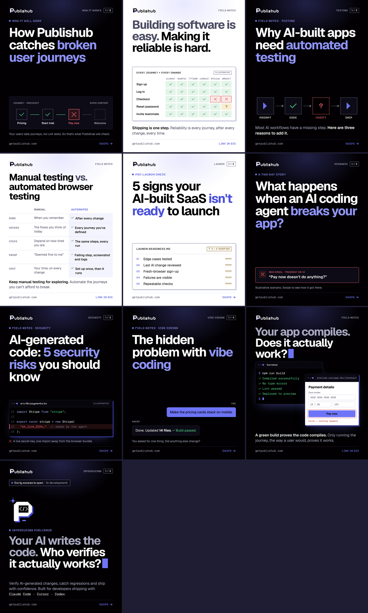

# Publishub · Instagram campaign

10 finished Instagram creatives for **Publishub** (getpublishub.com): 3 static posts and 7 carousels, **38 PNGs at 1080 × 1350 (4:5)**, with captions and previews, ready to publish.

## The brand, as it exists in the project

Everything here comes from the live site's code (`frontend/src/app/globals.css`, `components/Logo.tsx`, `lib/brand/logo-art.ts`, `components/ui/Pixel.tsx`, `components/waitlist/TerminalPreview.tsx`). Nothing was invented.

| | |
|---|---|
| **Logo** | The pixel-art "P" with the `</>` screen, indigo shadow, star and cursor, used as the P of **[P]ublishub**. Drawn from the exact same rectangles as the site |
| **Colors** | Black `#020002` · White `#FFFFFF` · Indigo `#6E74F7` (light theme accent `#4A50D9`). Green `#57D98C` only for *pass*, red `#FF6B75` only for *fail*, amber `#FFBF69` only for *inconclusive* |
| **Type** | Geist (headlines and text), Geist Mono (code, data, URLs), Pixelify Sans (labels, badges and the wordmark, never body copy) |
| **Motifs** | The site's dotted grid and indigo beam, hard "pixel" shadows, 7×7 pixel status icons, and the terminal-style `publishub verify` preview |

## Honesty rules this campaign follows

- **Publishub is in development.** The site offers a free waitlist and a Founding Customers reservation ($0 today, charged only after launch). No creative says or implies that the product is live, and the closing slides say so explicitly.
- **No fabricated screenshots.** The project contains no real product screenshots. Product visuals are recreations of the site's own *illustrative preview* (same demo data: 7 journeys, checkout regression, `CheckoutForm.tsx:42`) and are labelled **"Demo content"** on the image.
- **No invented features, numbers or testimonials.** Product copy is taken from the homepage (problems, the 4 "how it will work" steps, early-access tiers). Scenarios and code samples are labelled **"Illustrative"** / **"Scenario"**. The founding price isn't shown because it comes from Stripe at runtime.
- No integrations are claimed. Claude Code, Cursor and Codex are named only as tools the audience uses, as on the site.

## Folders

```
publishub-instagram-campaign/
├── creatives/   static posts: 02, 06, 08 (one PNG each)
├── carousels/   one folder per carousel: slide-01.png … slide-0N.png (upload in that order)
├── captions/    one .md per creative: caption, hashtags, objective, CTA
├── previews/    00-profile-grid.png (the feed in publishing order) + one contact sheet per creative
└── source/      the HTML/CSS/JS that draws every slide + the export script
```

## Recommended publishing order

Open with the introduction and pin it, so anyone landing on the profile knows what Publishub is. Then alternate hooks, stories and practical content. Close the cycle with the product walkthrough. Suggested cadence: 3 posts a week (e.g. Tue / Thu / Sat, US morning).

| # | Post | Format | Why here |
|---|---|---|---|
| 1 | **09 · Introducing Publishub: Test Your AI-Built Applications** | Carousel, 5 slides | Sets context for every profile visitor. **Pin it.** |
| 2 | **02 · Your App Compiles. Does It Actually Work?** | Static post | Broadest hook; easy to share |
| 3 | **04 · The Hidden Problem With Vibe Coding** | Carousel, 4 slides | Joins the vibe-coding conversation |
| 4 | **01 · AI-Generated Code: 5 Security Risks You Should Know** | Carousel, 5 slides | High save value; builds technical credibility. **Pin it.** |
| 5 | **07 · What Happens When an AI Coding Agent Breaks Your App?** | Carousel, 5 slides | Story that makes the cost felt |
| 6 | **03 · 5 Signs Your AI-Built SaaS Isn't Ready to Launch** | Carousel, 5 slides (light) | Self-diagnosis; drives comments |
| 7 | **08 · Manual Testing vs. Automated Browser Testing** | Static post (light) | Savable comparison |
| 8 | **05 · Why AI-Built Applications Need Automated Testing** | Carousel, 5 slides | Makes the case for the missing step |
| 9 | **06 · Building Software Is Easy. Making It Reliable Is Hard.** | Static post (light) | Quotable brand statement |
| 10 | **10 · How Publishub Helps You Catch Broken User Journeys** | Carousel, 6 slides | Product walkthrough to convert warmed-up followers. **Pin it.** |



---

## The creatives

### 01 · AI-Generated Code: 5 Security Risks You Should Know

- **Files:** `carousels/01-ai-generated-code-security-risks/` · preview: `previews/01-ai-generated-code-security-risks.png`
- **Format:** Carousel, 5 slides
- **Marketing objective:** Educate and earn saves. Build credibility with technical builders.
- **Suggested CTA:** Save this before your next deploy → join the waitlist (link in bio)
- **Publishing slot:** #4

**Caption**

Your agent wrote the feature in four minutes. Did it also put your Stripe key in the browser bundle?

AI coding tools are fast. They're also very relaxed about security unless you ask. Five things worth checking before anything AI-written goes live:

01 · Secrets in the wrong place. Anything prefixed NEXT_PUBLIC_ (or VITE_) ships to every visitor.
02 · Missing authorization. "Logged in" isn't the same as "allowed to see this record."
03 · Trusting user input. String-built SQL and raw HTML rendering are still how most injection bugs happen.
04 · Dependencies nobody checked. Make sure every package the agent added actually exists and is maintained.
05 · Insecure defaults. CORS set to *, debug mode on, database rules switched off to "make it work."

The checklist is on slide 4. Save it for your next deploy.

Security is half the question. The other half is whether your app still works after the change. That's the part we're building Publishub for. Join the early-access waitlist, link in bio.

#AppSecurity #AICoding #VibeCoding #IndieHackers #WebDev #ClaudeCode #Cursor #SaaS

---

### 02 · Your App Compiles. Does It Actually Work?

- **Files:** `creatives/02-your-app-compiles-does-it-work.png` · preview: `previews/02-your-app-compiles-does-it-work.png`
- **Format:** Static post
- **Marketing objective:** Pattern-interrupt hook and an easy share. States the core problem in one image.
- **Suggested CTA:** Comment with the last bug a green build let through → follow for more
- **Publishing slot:** #2

**Caption**

Build passed. Types checked. Lint clean. Deployed to preview.

And the Pay now button does nothing.

A compiler checks that your code is valid. It doesn't click anything. The bugs that cost you users (a form that never submits, a redirect that loops, an onboarding step that never loads) all compile fine.

When an AI agent writes the change, the gap gets wider: more code, more files touched, less of it read by a human.

Green checks tell you the code compiles. Only running the journey, the way a user would, tells you it works.

What's the worst bug a green build ever let through for you? Tell us in the comments.

#BuildInPublic #AICoding #SoftwareTesting #IndieHackers #SaaSFounder #WebDevelopment #VibeCoding

---

### 03 · 5 Signs Your AI-Built SaaS Isn't Ready to Launch

- **Files:** `carousels/03-signs-your-saas-isnt-ready-to-launch/` · preview: `previews/03-signs-your-saas-isnt-ready-to-launch.png`
- **Format:** Carousel, 5 slides (light)
- **Marketing objective:** Self-diagnosis content that drives saves, shares and comments from founders close to launch.
- **Suggested CTA:** Count how many apply and comment your score → join the waitlist
- **Publishing slot:** #6

**Caption**

You don't need a perfect app to launch. You need to know the important parts work.

Five signs you're not there yet:

01 · You've only tested the happy path.
02 · You can't say what the last AI change touched.
03 · Sign-up has never been run in a fresh browser.
04 · Failures happen silently. No error, no message, just a button that does nothing.
05 · "It worked when I clicked around" is your test plan.

If two or more sound familiar, don't push the launch back forever. Make your critical journeys repeatable first: sign up, log in, and the thing people pay for.

How many did you get? Drop your score below 👇

We're building Publishub to run those journeys in a real browser after every change. Early access is open, link in bio.

#SaaS #LaunchDay #IndieHackers #SaaSFounder #AIBuilders #Lovable #Bolt #BuildInPublic

---

### 04 · The Hidden Problem With Vibe Coding

- **Files:** `carousels/04-hidden-problem-with-vibe-coding/` · preview: `previews/04-hidden-problem-with-vibe-coding.png`
- **Format:** Carousel, 4 slides
- **Marketing objective:** Join the vibe-coding conversation without dunking on it. Position Publishub on the builder's side.
- **Suggested CTA:** Share with someone who ships with Cursor or Claude Code → join the waitlist
- **Publishing slot:** #3

**Caption**

Vibe coding works. That's not the problem.

You ask for one thing: "make the pricing cards stack on mobile." The agent says done, the build passes and the page looks great.

Then you look at the diff. Fourteen files. One of them is your checkout form.

Agents touch more than the task. Shared helpers, styles, utilities: a tidy-up in one place quietly breaks a flow somewhere else, and nothing in your pipeline goes red.

The answer isn't to stop vibe coding. It's to verify the app, not just the code: run the journeys your users take, after every change.

Writing code got faster. Knowing it works didn't. We're working on that part. Early access at getpublishub.com (link in bio).

#VibeCoding #ClaudeCode #Cursor #AICoding #IndieHackers #BuildInPublic #DevTools

---

### 05 · Why AI-Built Applications Need Automated Testing

- **Files:** `carousels/05-why-ai-built-apps-need-automated-testing/` · preview: `previews/05-why-ai-built-apps-need-automated-testing.png`
- **Format:** Carousel, 5 slides
- **Marketing objective:** Make the case for verification as the missing step in AI workflows.
- **Suggested CTA:** Save this and send it to your co-founder → join the waitlist
- **Publishing slot:** #8

**Caption**

Prompt → code → ship. Most AI workflows skip a step.

Three reasons AI-built apps need automated tests more than hand-written ones:

01 · There's more code than you can review. A "small" refactor touches 14 files. You skim three.
02 · Regressions land outside the task. You fixed the navbar. Password reset stopped sending emails.
03 · Manual checks don't repeat themselves. You tested sign-up on Monday. Four changes later, nobody has checked it again.

Automated tests run the same steps every time, at the speed you ship. For AI-built apps, the ones that matter most run real user journeys in a browser.

That's what we're building Publishub to do. Join the early-access waitlist, link in bio.

#SoftwareTesting #TestAutomation #AICoding #SaaS #IndieHackers #WebDev #ClaudeCode

---

### 06 · Building Software Is Easy. Making It Reliable Is Hard.

- **Files:** `creatives/06-building-is-easy-reliability-is-hard.png` · preview: `previews/06-building-is-easy-reliability-is-hard.png`
- **Format:** Static post (light)
- **Marketing objective:** A quotable brand statement. Reinforce the positioning: reliability, not code generation.
- **Suggested CTA:** Follow for practical notes on shipping AI-built software
- **Publishing slot:** #9

**Caption**

Building software has never been easier. A weekend, an agent and a good prompt get you surprisingly far.

Reliability is a different job. It isn't one check. It's every journey, after every change, every time.

Look at the grid: five journeys, six changes. Everything is green until one commit breaks checkout, and it stays broken until someone notices. Usually a user.

Shipping is one step. Reliability is the habit.

Follow for practical notes on shipping AI-built software that keeps working.

#SoftwareEngineering #SaaS #AIBuilders #IndieHackers #BuildInPublic #DevTools

---

### 07 · What Happens When an AI Coding Agent Breaks Your App?

- **Files:** `carousels/07-when-an-ai-agent-breaks-your-app/` · preview: `previews/07-when-an-ai-agent-breaks-your-app.png`
- **Format:** Carousel, 5 slides
- **Marketing objective:** Storytelling. Make the cost of an unverified change felt, then show the alternative.
- **Suggested CTA:** Tag a friend who has lived this → join the waitlist
- **Publishing slot:** #5

**Caption**

"Pay now doesn't do anything?"

That's how you find out. Not from your build, not from your tests: from a user, two days later.

Here's how it usually happens (an illustrative scenario, though you may recognise it):

Tuesday, 10:02. You ask the agent to make the pricing cards stack on mobile. It does, and "cleans up the shared form helpers while it's there."
Tuesday, 10:09. It ships. The pricing page looks perfect on your phone. You don't open checkout. Why would you?
Thursday, 08:14. A user emails. The checkout form throws an error in the console and the payment request never leaves the browser.

What should have happened: the checkout journey runs right after the change, fails, gets flagged as a regression because it passed on main, and the fix happens on Tuesday.

That moment is what Publishub is being built for. Early access is open, link in bio.

#AICoding #ClaudeCode #Cursor #VibeCoding #SaaSFounder #IndieHackers #Regression

---

### 08 · Manual Testing vs. Automated Browser Testing

- **Files:** `creatives/08-manual-vs-automated-browser-testing.png` · preview: `previews/08-manual-vs-automated-browser-testing.png`
- **Format:** Static post (light)
- **Marketing objective:** A clear, savable comparison that frames automation without dismissing manual testing.
- **Suggested CTA:** Which column are you in today? Comment below
- **Publishing slot:** #7

**Caption**

Manual testing isn't wrong. It just doesn't scale with how fast AI lets you ship.

Manual: runs when you remember, covers the flows you think of today, and the proof is "seemed fine to me."
Automated browser testing: runs after every change, covers every journey you've defined, and leaves evidence (the failing step, a screenshot, the logs).

Keep manual testing for exploring: it's how you find out what to automate. Then automate the journeys you can't afford to break.

Which column are you in today? Be honest 👇

#SoftwareTesting #QA #TestAutomation #WebDev #IndieHackers #SaaS #AICoding

---

### 09 · Introducing Publishub: Test Your AI-Built Applications

- **Files:** `carousels/09-introducing-publishub/` · preview: `previews/09-introducing-publishub.png`
- **Format:** Carousel, 5 slides
- **Marketing objective:** Introduce the product honestly (in development, early access open) and drive waitlist sign-ups and Founding Customer reservations.
- **Suggested CTA:** Join the free waitlist or reserve a Founding Customer spot ($0 today) at getpublishub.com
- **Publishing slot:** #1

**Caption**

Your AI writes the code. Who verifies it actually works?

That's the question behind Publishub, a verification tool we're building for software written with AI coding agents like Claude Code, Cursor and Codex.

How it will work:
01 · Connect your project, such as a preview deployment, and pick the user journeys that matter.
02 · Publishub runs those journeys in a real browser after a change, the way a user would.
03 · Each result is compared with the last version that worked, so you see what this change broke.
04 · You get the failing step, a screenshot and a bug report you can hand straight back to your agent.

To be clear: Publishub is in development. There's no launch date yet, and the preview on slide 4 uses demo content. Early access is open now:

→ Free waitlist: product updates and a note the moment we launch.
→ Founding Customers: reserve a spot for $0 today; the founding price is only charged after launch, and you get notice first.

Both at getpublishub.com (link in bio). Tell us which AI tool you use when you join, and we'll prioritize it.

#Publishub #BuildInPublic #AICoding #ClaudeCode #Cursor #IndieHackers #SaaS #DevTools

---

### 10 · How Publishub Helps You Catch Broken User Journeys

- **Files:** `carousels/10-how-publishub-catches-broken-journeys/` · preview: `previews/10-how-publishub-catches-broken-journeys.png`
- **Format:** Carousel, 6 slides
- **Marketing objective:** Explain the planned workflow step by step and convert interested builders to the waitlist.
- **Suggested CTA:** Join the waitlist and tell us which journeys you'd verify first
- **Publishing slot:** #10

**Caption**

Your users don't run unit tests. They sign up, pick a plan and click Pay now. So that's what Publishub will check.

How it's designed to work:

Step 01 · Pick the journeys that matter: sign-up, log-in, checkout, password reset.
Step 02 · Run them in a real browser after a change, with the same clicks and form fills a user would make.
Step 03 · Compare with the last version that worked. If checkout passed on main and fails on this change, that's a regression, and you know exactly what caused it.
Step 04 · Get evidence you can act on: steps to reproduce, a screenshot of the failing step, console and network errors, and a bug report to hand back to your coding agent.

Publishub is in development, the screens here are demo content, and the workflow may change as we build it with early-access members.

Which journey would you verify first? Comment below, then join the waitlist at getpublishub.com (link in bio).

#Publishub #UserJourney #E2ETesting #AICoding #SaaSFounder #IndieHackers #DevTools #BuildInPublic

---

## Before posting

- **Link in bio:** point it at `https://getpublishub.com/?utm_source=instagram&utm_medium=social&utm_campaign=ig_launch` so sign-ups show up by source in the /admin waitlist report (it already groups by `utm_source`/`utm_campaign`).
- **Alt text:** Instagram → Advanced settings → *Write alt text*. Use the slide's headline plus one line on what the visual shows.
- **Crop:** upload at 4:5. The profile grid crops to the center 3:4, and every cover keeps its headline inside that area.
- **Handle:** the captions don't mention the account handle. Add it where you want people to tag you.

## Editing and re-exporting

All copy lives in `source/posts.js`; styles are in `source/campaign.css`. To preview one slide, open `source/slide.html?post=03&slide=2` in a browser.

```bash
cd publishub-instagram-campaign/source
node render.mjs          # every slide → ../creatives and ../carousels (exactly 1080 × 1350)
node render.mjs 03 07    # only those posts
python3 previews.py      # rebuild ../previews (needs Pillow)
```

`render.mjs` uses Playwright's Chromium and warns if any text overflows the frame. Fonts are embedded in `source/fonts/` (Geist and Geist Mono from the repo; Pixelify Sans, SIL Open Font License, from `@fontsource-variable/pixelify-sans`).
